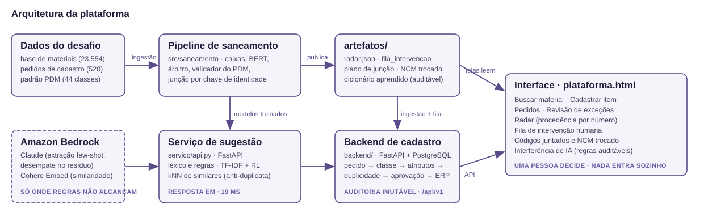
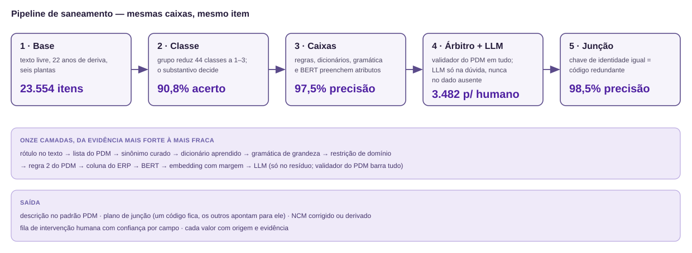

# vxwinners — Cadastro e saneamento de materiais

Hackathon VX · **Desafio 01**. Empresa fictícia *Serra Azul Mineração e Energia*: seis plantas,
**23.554 materiais cadastrados**, 22 anos de deriva e um padrão descritivo (PDM) que 79% da base
não cumpre. O problema tem três frentes — **sanear** a base que existe, **padronizar** o que está
chegando e **enriquecer** o que falta — e a plataforma deste repositório ataca as três.

| Campo | Vazios na base | % |
|---|---:|---:|
| `REFERENCIA_FABRICANTE` | 18.488 | 78,5% |
| `FABRICANTE` | 15.674 | 66,5% |
| `NCM` | 1.173 | 5,0% |

Sem fabricante e sem part number, a chave de identidade que o PDM define para sobressalentes e
filtros (regra 10) é impossível de calcular — e é nessas classes que está a maior parte do valor
do estoque. Preencher esses campos é o que destrava a deduplicação.

---

## Arquitetura da plataforma

- **Pipeline de saneamento** (`src/saneamento/`) — transforma cada descrição em uma grade de
  caixas (atributos do PDM), com onze camadas da evidência mais forte à mais fraca; a junção é por
  **igualdade de chave de identidade**, nunca por semelhança de texto. Publica tudo em `artefatos/`.
- **Serviço de sugestão** (`servico/`) — FastAPI servindo os vencedores do benchmark: léxico e
  regras, TF-IDF + regressão logística e kNN de similares para anti-duplicata. Responde grupo,
  NCM, fabricante, part number e os 5 itens mais parecidos em **~19 ms**.
- **Backend de cadastro** (`backend/`) — FastAPI + PostgreSQL: conduz o pedido do texto livre à
  aprovação (classe confirmada por pessoa, atributos sugeridos pelo histórico, checagem de
  duplicidade antes de criar), com exceções, segundo analista, auditoria imutável e envio ao ERP.
- **Interface** (`plataforma.html` + `frontend/`) — Buscar material, Cadastrar item, Pedidos,
  Revisão, **Radar** (cada número com procedência: medido, estimado, premissa ou *não medido*),
  **Fila de intervenção humana**, **Códigos juntados e NCM trocado** e **Interferência de IA**
  (cada regra aprendida é auditável e pode ser derrubada).
- Três decisões de projeto: **sugestão não preenche campo sozinha**; **"já existe" vem dos
  atributos, não do texto**; **classe é sempre confirmada por uma pessoa**.

Subir tudo: `./rodar.sh` (prepara ambiente, modelos e banco na primeira execução e abre
`http://localhost:8000/`).

## Pipeline de saneamento

A ideia em uma frase: **transformar cada linha num conjunto de caixas padronizadas; quando duas
grades têm as mesmas caixas, é o mesmo item.** A LLM entra apenas nas caixas em dúvida — nunca no
dado ausente — e toda proposta, venha de regra, BERT ou LLM, passa pelo validador do PDM antes de
entrar na base.

---

## O que usamos da AWS

- **Amazon Bedrock** (`us-east-1`) — toda a parte de modelos de linguagem e embeddings:
  - **Claude (Anthropic)** — Haiku 4.5, Sonnet 5 e Fable 5: extração few-shot com vocabulário
    fechado no preenchimento de fabricante, desempate do resíduo do pipeline (termo a termo) e os
    comparadores do benchmark (3 modelos × 2 protocolos);
  - **Cohere Embed v4** — embeddings das descrições para o kNN de similares e o blocking de
    duplicatas.
- Chamadas com retry/backoff, contagem de tokens e cache em disco
  ([`preenchimento/bedrock_util.py`](preenchimento/bedrock_util.py)); structured output com
  vocabulário fechado para impedir valor fora do PDM.
- Depois de treinados, os modelos de sugestão rodam **localmente** (`servico/modelos/`): a
  plataforma funciona offline, e o Bedrock fica reservado às etapas de enriquecimento e ao
  desempate — só onde regras não alcançam.

**Quanto isso custou.** **US$ 40,35** de LLM nesta base de 23.554 registros, em 23.595 perguntas
ao modelo (mais US$ 173,62 do benchmark, que é pesquisa e não se repete por cliente). Se o LLM
fosse a única camada, a mesma base custaria **US$ 228,59** por execução — 5,7× — e acertaria
menos em 3 dos 4 campos de identidade. A conta completa, com o método e as ressalvas, está em
[`docs/16-custo-de-llm.md`](docs/16-custo-de-llm.md); `scripts/27_custo_llm.py` a reproduz sem
chamar o Bedrock.

---

## Resultados

**Pipeline de saneamento, medido em gabarito rotulado:**

| Indicador | Resultado |
|---|---|
| Acerto de classe | **90,8%** (218 de 240) |
| Precisão dos atributos (caixas) | **97,5%** · IC 95% de 96–98%, em 1.131 rótulos |
| Junção: precisão / recall | **98,5% / 97,0%** |
| Capital consolidável identificado | **R$ 30,24 mi** (15,1% do estoque · 2.676 códigos em 1.991 grupos) |
| Fila de intervenção humana | 3.482 itens · **1.478 resolvem em um clique** · R$ 10,84 mi |
| NCM | 1.104 trocados · 597 preenchidos · 8.063 reformatados |

**Benchmark de preenchimento — 10 soluções × 4 campos, split de teste congelado**
(acurácia top-1; **negrito = vencedor do campo**):

| Solução | Grupo | NCM | Fabricante | Referência |
|---|---:|---:|---:|---:|
| `regras` | 96,2% | 46,9% | 73,9%¹ | **84,4%** |
| `tfidf_lr` | 96,5% | **91,1%** | 82,2% | 6,1% |
| `knn_cohere` | **96,6%** | 90,2% | 80,9% | 9,5% |
| `llm_fewshot_haiku` | 96,5% | 88,7% | 83,3% | 81,1% |
| `llm_fewshot_sonnet` | **96,6%** | 87,3% | **84,3%** | 81,2% |
| `llm_fewshot_fable` | 96,5% | 90,4% | 84,1% | 82,6% |
| `llm_naive_haiku` | 0,0% | 2,6% | 75,1% | 78,7% |
| `llm_naive_sonnet` | 0,0% | 42,7% | 78,1% | 80,6% |
| `llm_naive_fable` | 0,0% | 76,7% | 79,4% | 79,7% |
| `prior` | 32,4% | 46,9% | 16,2% | 0,0% |

¹ `regras` abstém em 26% dos casos; **nos que cobre, acerta 99,9%** — é precisão, não cobertura.
Benchmark completo (cobertura, top-3, F1, tempos): [`preenchimento/benchmark.csv`](preenchimento/benchmark.csv).

**As duas conclusões do benchmark:**

1. **Engenharia de prompt vale mais que modelo maior.** Em grupo de mercadoria, as três LLMs
   ingênuas acertam 0,0% — sem receber o vocabulário, nenhum modelo adivinha que o rótulo é
   `SOB01`. A mesma família de modelos, com a lista de valores válidos e três exemplos, chega a
   96,6%. O ganho está na lista fechada, não no modelo.
2. **O vencedor é quase sempre a solução mais simples.** `tfidf_lr` ganha NCM (91,1% top-1 e
   98,9% em três candidatos) sem nenhuma chamada de API; `regras` ganha referência, porque part
   number é problema de extração. A LLM só vence onde nada determinístico alcança: fabricante
   quando o nome não está escrito no texto. Daí a cascata do preenchimento real: **regras
   primeiro, LLM só no resto.**

**Preenchimento dos campos vazios reais** ([`preenchimento/saida/`](preenchimento/saida/), cada
linha com método, confiança e três candidatos):

| Campo | Vazios | Resultado |
|---|---:|---|
| `NCM` | 1.173 | **1.173 preenchidos**, confiança média 0,85 |
| `FABRICANTE` | 15.674 | **15.674 preenchidos** (2.765 por léxico, 12.909 por LLM few-shot) |
| `REFERENCIA_FABRICANTE` | 18.488 | 7.728 extraídas · **10.760 pendências explícitas** (o texto não traz o dado — abster é o comportamento certo) |
| `GRUPO_MERCADORIA` | 0 | **363 rótulos suspeitos detectados** (modelo discorda do cadastro com confiança ≥ 0,90) |

**Conjunto-ouro de avaliação** ([`avaliacao/`](avaliacao/)): 456 rótulos verificados com dupla
anotação independente, em seis estratos (produtos reais, erros de digitação, âncoras, faltantes e
abreviações) — precisão do preenchimento **96,2% [94–98%]** nos rótulos verificáveis, com a taxa
de invenção medida à parte. O avaliador (`evaluate.py --paths tabela.csv`) confronta qualquer
tabela preenchida com o ouro e gera relatório com intervalo de confiança e as linhas erradas
anotadas.
